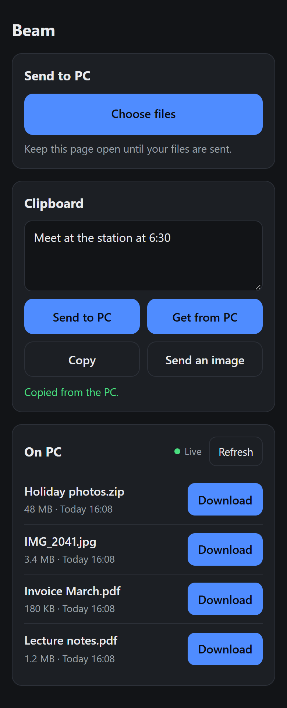

# Beam

Send files between your PC and your phone over Wi-Fi. Run Beam on the PC, scan the QR code with your phone, and use the page that opens. There's nothing to install on the phone and no account, and nothing goes through the internet.

<p align="center">
  
</p>

- **Phone to PC:** pick files on the phone; they land in a folder on the PC, with a progress bar for each.
- **PC to phone:** files in that folder show up on the phone, ready to download. The list updates live as files are added.
- **Share from anywhere, without copying.** Switch the shared folder while Beam runs, or share single files from another drive. Nothing is copied onto the PC, which matters when its disk is full.
- **Direct connection, no router needed (Windows).** Beam can turn the PC into a Wi-Fi hotspot that the phone joins by scanning a code, so files go straight between them. Usually much faster than through a router.
- **Big files are fine.** Files are streamed to and from disk, never held in memory, so a multi-gigabyte video transfers like a small one. Downloads can resume.
- **Clipboard on request:** send text or an image to the PC's clipboard, or tap **Get from PC** to fetch what's on it: text, a screenshot, or an image file copied in Explorer. Beam never sends the PC's clipboard unless you tap.
- **One small program.** The phone page is built into it, and it works with no internet connection.

## Quick start

1. Download Beam for your PC from the [Releases](https://github.com/MikeyA-yo/beam/releases) page.
2. Run it. A QR code appears in the terminal, and a larger one opens in your browser.
3. Scan the QR code with your phone's camera, with the phone on the same Wi-Fi as the PC.

Files you send from the phone go to `Downloads/Beam` on the PC. Put files there (or pass them to Beam, see below) to make them available on the phone. Press **Ctrl+C** in the terminal to stop; the QR code stops working at the same moment.

### Windows

Double-click `beam-…-windows-x86_64.exe`, or run it from a terminal. Rename it to `beam.exe` and put it in a folder on your `PATH` to use it as the `beam` command.

The first time, you may see:

- **"Windows protected your PC"** (SmartScreen). Beam isn't code-signed yet. Click **More info**, then **Run anyway**.
- **A Windows Firewall prompt.** Allow access on **private networks**, otherwise the phone can't connect.

### macOS and Linux

Extract the archive and run `./beam` in a terminal. On macOS, if Gatekeeper refuses to open it because it's from an unidentified developer, run `xattr -d com.apple.quarantine beam` once.

### From source

With [Rust](https://rustup.rs) 1.88 or newer:

```
cargo install --git https://github.com/MikeyA-yo/beam
```

## Usage

```
beam [OPTIONS] [FILES]...
```

| Command | What it does |
|---|---|
| `beam` | Share `Downloads/Beam` on port 8080 |
| `beam E:\Movies\film.mkv` | Also offer these files to the phone, from wherever they are: another drive, an external SSD. They're served in place, never copied. |
| `beam --dir D:\Transfers` | Share a different folder |
| `beam --port 9000` | Use a different port. If the port is taken, Beam tries the next few on its own. |
| `beam --no-open` | Don't open the QR code page in the browser; the terminal QR code is enough |
| `beam --hotspot` | Windows: turn this PC into a Wi-Fi hotspot and connect the phone straight to it (see below). Handy in a desktop shortcut. |
| `beam --help` | Show all options |

### Connect the phone directly (Windows)

On the page that opens in your PC's browser, pick **Direct to this PC** and click **Turn on this PC's hotspot**, or start Beam with `beam --hotspot`. Then, on the phone:

1. Scan the first QR code with the camera and tap **Join**. The phone joins the PC's own Wi-Fi.
2. Scan the second QR code to open Beam.

Files then go straight between phone and PC instead of through a router, so every byte crosses the air once instead of twice, and Beam asks Windows for the faster 5 GHz band. Beam uses your Windows hotspot's existing name and password, and turns the hotspot off again when it stops (if it turned it on).

- **Speed depends on the band.** If the PC's own Wi-Fi is on 2.4 GHz, Windows may have to run the hotspot on 2.4 GHz too. Connecting the PC by cable, or to 5 GHz Wi-Fi, lets the hotspot use 5 GHz.
- **Already on your phone's hotspot?** Then the PC and phone are already connected directly. For more speed, set the phone's hotspot to 5 GHz in its hotspot settings.
- **Phone joined but Beam won't open?** Windows treats the hotspot as a public network. Allow Beam through Windows Firewall on **public** networks too.

### Share another folder without restarting

The page that opens in your PC's browser, under the QR code, has a **Shared folder** box. Paste a folder path (in File Explorer, right-click the folder and choose **Copy as path**) and click **Share**. The phone's list switches straight away, uploads go to the new folder, and the phone stays connected. Folders you shared earlier are listed there to switch back with one click, along with any files shared from elsewhere and a **Stop sharing** button for each.

Only the PC can do this. The phone can't change or even see which folder is shared, beyond its name.

Beam never overwrites anything: if a file with the same name exists, the new one is saved as `name (1).ext`. A transfer that's cut off leaves no partial file behind.

## If the phone can't connect

- **Same network.** The phone and the PC must be on the same Wi-Fi.
- **Firewall.** On Windows, allow Beam through Windows Firewall on private networks, and make sure the Wi-Fi network is set to **Private**, not Public (Settings → Network & internet → Wi-Fi → your network).
- **Networks that block devices from seeing each other**, common on campus, hotel and office Wi-Fi. Use **Direct to this PC** (Windows), or turn on your phone's hotspot and connect the PC to it. Beam works the same way, and the transfer doesn't use mobile data.
- **Slow transfers?** Check the PC's Wi-Fi band: 2.4 GHz manages a few MB/s at best, 5 GHz several times that. Use 5 GHz Wi-Fi, a cable for the PC, or the direct connection above.
- **Several network adapters** (VPN, virtual machines). Beam prints every address it finds, and the browser page lets you switch between their QR codes. Try another one.

## Security

Beam is meant for networks you trust, like your home Wi-Fi or your own hotspot.

- **Only someone with the QR code can connect.** It carries a random key, which is new every time Beam starts. The phone keeps it as a login cookie for at most 24 hours, and it stops working as soon as Beam stops.
- **The connection is not encrypted.** Beam uses plain HTTP, so someone on the same network who can watch its traffic could see the files you send. Avoid public Wi-Fi, or use your phone's hotspot.
- **Only what you share is exposed:** the shared folder, and any single files you add. File names from the phone are cleaned, so they can't escape the folder or overwrite files, and downloads can't reach anything else. Only the PC itself can change what's shared, never the phone.
- **The clipboard is read only when you tap Get from PC.** Its contents never appear in Beam's log; only the type and size do.
- **Beam makes no internet connections and collects no data.**

## Platform support

| | Status |
|---|---|
| Windows 10 and 11 | Main platform, tested |
| macOS, Linux | Built and tested automatically, but less tried in real use. Clipboard images are Windows-only for now; clipboard text works everywhere. |
| Android (Chrome) | Tested |
| iPhone (Safari) | Tested |

## Building

```
cargo build --release
cargo test
```

The binary ends up in `target/release/`. The phone page lives in [`web/index.html`](web/index.html) and is built into the binary, so there's no separate frontend build. [PRD.md](PRD.md) describes how Beam is meant to behave.

## License

Licensed under either of [Apache License, Version 2.0](LICENSE-APACHE) or [MIT license](LICENSE-MIT), at your option.
